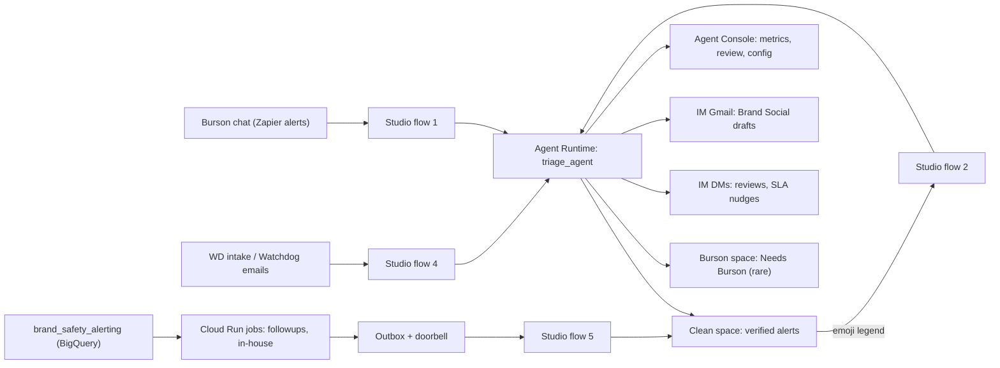

# SLRR Alert Automation Agent

> **V1 (rolling out first): the Burson QA bot in [`apps-script-chat-bot/`](apps-script-chat-bot/README.md).**
> An Apps Script poller reviews every Zapier alert in the Burson space. It asks Burson to fix mistakes and answers
> their questions, and it forwards every alert, already corrected, to the analyst space. It's managed from the
> Control tab of its Google Sheet (Bot ON/OFF, the two spaces, and switches for what it may do on its own, all OFF to
> start). With **Work directly in B25** (row 32) it can also be tried right in another Google-only space, where alerts in
> other formats get their own triage (the SLRR rules first, then the stream's own call), or beside the Mirror space in an
> **Other alerts space** (B33). **Proactive watch** (row 34) tries to catch issues before Burson does: every 5
> minutes Gemini, inside BigQuery, checks what's new in every source the bot can read (Sonar, Brandwatch, Sprinklr,
> Tubular, the DSD story selection feed, the Other alerts space's alerts, the Brandwatch query "2026 Election Alerts") against the watches on a Watches tab, read-only (posts by Grok, X's AI account @grok, are left out from every source), and
> records what it would flag, with a scorecard against Burson's alerts (nothing is posted unless **Watch alerts**, row 35, says where: the Other alerts space, the Mirror space or the Auto-correct space, as the bot's own 🔭 Watch alerts: the post's link as a hyperlink, its author, when it was posted and a summary, with the post's picture attached). Its taxonomy and settings are generated from
> `config/default_config.yaml`. The rest of this README describes the full Python agent (escalation, T&S, Studio
> flows, Console), which stays in the repo for V2 and later.

Automates the SLRR Incident Manager (IM) workflow and takes Burson out of the
critical path. Burson/Sonar alerts posted to **[S-F] Burson Automated Alerts V3**
go through the agent, which:

- **QAs each alert in seconds** against the March 5, 2026 Collection Requirements.
- **Fixes what it can** (old → new shown on the post) instead of asking Burson to correct and retrigger.
- Posts verified alerts to the clean **SLRR Triaged Alerts** space.
- Bounces to the Burson on-call **only** for unfixable source data, such as a missing link.

The IM then reacts with the existing emoji legend and the agent does the work:
- Social Alert drafts in the IM's Gmail from the Brand Social alias, including thread replies for ongoing issues.
- Distribution-list routing.
- go/WD-Triage pre-fill, the T&S intake/outcome/bug-ID loop, and the protocols.

There is **no Chat API configuration and no webhooks**. Chat I/O runs through Google Workspace Studio flows owned by a dedicated Triage Agent account. The agent and Gemini run on the **Gemini Enterprise Agent Platform** (Agent Runtime, formerly Vertex AI Agent Engine).

## Burson: before → after

| Today (IM workflow) | With the agent | Burson's part after |
|---|---|---|
| IM checks every alert's product, exposure tag, sensitive topics, KOF, engagement, link and issue name | Checked in seconds against the Collection Requirements | — |
| IM asks Burson to correct and retrigger | Agent fixes it itself (old → new on the post); the IM confirms only low-confidence changes | Async daily correction digest |
| Unfixable data (missing/dead link, missing author or content) | Narrow "Needs Burson" message to the Burson on-call (roster, reminders, backup); the rerun is matched to the same case automatically | Fixes source data only |
| Long video without a timestamp → ask Burson | Gemini fills the timestamp | — |
| Watchdog email with no alert → send the link to Burson | Agent reads the Watchdog email and creates the alert (skips early warnings, jailbreaks, NSFW images) | — |
| Burson's Sonar Smart Alerts create every alert | **Path B:** alerts generated in-house from Sonar data with the `brand_safety_alerting` rules, run in parity with Burson, then cut over | Keeps the Sonar feed running |
| Watching the chat for the 15-min SLA | SLA timers per platform; DMs to the IM on shift when at risk | — |



## Repo map

| Path | What |
|---|---|
| [`docs/CONTRACTS.md`](docs/CONTRACTS.md) | **The spec**: operations, payloads, Studio outputs, events, Console API |
| `triage_agent/qa/` | Parser, rules + mechanical corrections, Gemini assessment, Collection Requirements engine, pipeline |
| `triage_agent/triage.py` · `review.py` · `followups.py` · `inhouse.py` | Intake, IM decisions, minute-level jobs, Path B |
| `triage_agent/escalation/` · `actions.py` · `emails.py` · `converse/` | Gmail drafts, T&S, emoji actions, agent inbox, conversation |
| `triage_agent/{models,config,store,events,metrics,operations,outbox,routing,render}.py` | Shared foundation |
| `config/default_config.yaml` · `config/distribution.yaml` | Collection Requirements, protocols, emoji legend, routing (editable in the Console) |
| `evals/` | Golden set: agent decision vs. IM decision |
| `scripts/simulate.py` | Local end-to-end simulation of the Studio flows |
| `console/` | Agent Console (FastAPI + React) |
| `studio-addon/` · `flows/` · `analytics/` · `infra/` | Studio custom steps, flow setup + Phase 0 spike, BigQuery views, deployment |

## Quickstart (local, offline)

```bash
python3.12 -m venv .venv && .venv/bin/pip install -r requirements.txt   # once
TRIAGE_LLM=fake .venv/bin/python -m pytest -q                          # all tests
TRIAGE_LLM=fake .venv/bin/python -m evals.run_evals                    # golden set (24 cases)
.venv/bin/python -m scripts.simulate --db .local/demo.db               # a full IM shift through every flow
```

The simulation prints what each Studio flow would post, then the Console KPIs. It covers:
- Burson alerts (pass, auto-correct, suppress, bounce);
- IM reactions (draft, T&S pre-fill, add Civics), a revision in the thread, and the IM sending from Gmail (SLA met);
- the review queue, Burson's corrected rerun, a Burson-space question and teaching the agent;
- the T&S intake/outcome emails, the minute job and the outbox.

Then open the Agent Console on the same DB (see [`console/README.md`](console/README.md)).

Use real Gemini with `--live` (needs `GOOGLE_CLOUD_PROJECT` and ADC):

```bash
.venv/bin/python -m evals.run_evals --live
```

## How decisions are made

- **Same rules as Path B:** `qa/requirements.py` mirrors `brand_safety_alerting/sql/02_brand_safety_alerts.sql`, covering:
  - sensitive topics (redundant risk tags, Politics nuance, briefed launches);
  - exclusions;
  - URGENT vs. 2K+ tracks;
  - the 14-day novelty rule;
  - "ongoing URGENT needs a KOF";
  - the YouTube, Doodle and leadership protocols;
  - the T&S recommendation.
- **One Gemini call per alert** (`qa/llm_assess.py`) judges the exposure tag, product, risk tags, KOF, issue name and summary. It also fills the Alert Assistant's manual inputs: Sundar mention, markets, products #2/#3, owned post, video timestamp.
- **Correction policy:**
  - Corrections are auto-applied at ≥ 0.85 confidence; the post link is never auto-corrected.
  - Lower-confidence proposals go to the IM on shift as a review DM.
  - IMs can revert any correction (Console, or `revert TRG-… field`).
- **Verdicts:**

  | Verdict | Effect |
  |---|---|
  | PASS / CORRECTED | Clean post |
  | SUPPRESSED | Logged, with the reason |
  | NEEDS_REVIEW | IM DM |
  | FAIL | Burson on-call |

## Configuration

- Everything rule-like lives in `config/*.yaml` and can be overridden per section from the Console's Settings page. Every event records the config version.
- Values marked `PLACEHOLDER` need real inputs:
  - the alert template labels (from real Burson samples);
  - space ids, IM shift roster, Burson roster;
  - missing distros (GCPA, GSOC, Regional Leads, Channel Owner, Brand);
  - leadership recipients (Angie);
  - go/WD-Triage entry ids;
  - the doorbell sheet.
- See `flows/PHASE0_SPIKE.md` for how to collect them.

## Deploy

Start with the Phase 0 spike ([`flows/PHASE0_SPIKE.md`](flows/PHASE0_SPIKE.md)), then follow:
- [`infra/README.md`](infra/README.md): APIs, service accounts, Firestore, BigQuery, the Agent Runtime, jobs, Console + IAP, Gmail OAuth, and the cutover to production.
- [`studio-addon/README.md`](studio-addon/README.md): the custom steps.
- [`flows/FLOW_SETUP.md`](flows/FLOW_SETUP.md): the Studio flows.

---

## Brandwatch Deep Dives & Alert Campaigns (`slrr-campaigns`)

`slrr_campaigns/` is a private Cloud Run service (`slrr-campaigns`, `us-central1`, GCP project `brand-social-central-data`) invoked by Cloud Scheduler OIDC jobs (`/tick` every minute, `/hourly` once per hour, `/daily` once per day). It lets Incident Managers and analysts trigger Brandwatch deep dives and topic-focused alert campaigns in plain language inside any alert thread in the SLRR alerts mirror space (`spaces/AAQAnWE2vpo`), while normal alerting continues untouched alongside it. All output written by `slrr-campaigns` contains zero emojis.

### 1. Setup & Quality Gates

Resource identifiers live in [`config/campaigns.yaml`](config/campaigns.yaml); secrets live exclusively in Secret Manager (`slrr-campaigns-*`).

```bash
# Run all static, dead-code, config-parity, shellcheck, and Apps Script ESLint gates:
./check.sh

# Idempotent end-to-end provisioning, build, Cloud Run deploy, Scheduler setup, and live preflight:
./setup.sh

# Optional: pass a newly created OAuth Desktop client JSON from brand-social-central-data on first run:
./setup.sh --oauth-client-json /path/to/client_secret.json

# Run live integration tests against real Brandwatch, Chat, Gmail, Drive/Sheets/Docs, Gemini, and People APIs:
.venv/bin/pytest -m live
```

One-time manual inputs during first `./setup.sh` execution:
1. Create an OAuth Desktop client in `brand-social-central-data` (the GCP project with the configured Google Chat app) if not yet stored in `slrr-campaigns-oauth-client`.
2. Complete the one-time browser consent (`scripts/authorize_user.py` stores client JSON and refresh token in Secret Manager).
3. Enter Brandwatch API username and password once (hidden prompt; `./setup.sh` mints and stores `slrr-campaigns-bw-token`).

### 2. Triggering in Chat & Thread Ownership

Reply in plain language inside any alert thread in `spaces/AAQAnWE2vpo`:
- **Deep dive:** e.g. `"run a 48h Brandwatch deep dive on this alert"` — queries BigQuery mention tables (`all_sundar_mentions`, `brandwatch_mentions`) and up to 8 Brandwatch data calls, writes a Google Doc report in the configured Drive folder, posts a plain-text summary in the thread (calling out any platforms where the API strips post text), and offers to launch a prefilled alert campaign.
- **Alert campaign:** e.g. `"start a focused alert campaign for this topic"` — walks through numbered plain-text steps (`1`, `2`, `3`, or plain-language answers; `cancel` at any step; field-name jump-edits on the confirmation summary; 24-hour inactivity expiry).
  - **Existing Brandwatch query:** maps from the alert or searches/ranks up to 5 cached queries across accessible projects, then configures Custom Alert filters (`pageType`, `threadEntryType`, `sentiment`).
  - **New Brandwatch query (Query Builder):** collects core terms, context/proximity, alternate phrases, exclusions, platforms, languages, locations, explicit `startDate` (default today ET), and daily mention cap; drafts and validates `booleanQuery` via `POST /query-validation`; and pauses until an authorized approver listed in Registry `Settings` replies `approve` in the thread.

When `SLRR Triage Chat Agent` (`apps-script-chat-bot/`) detects a deep-dive or campaign request in `spaces/AAQAnWE2vpo`, `CampaignHandoff.gs` writes a `thread_ownership` document in Firestore (`slrr-social-alerts`), replies once (`"Campaign assistant now owns this thread and will reply shortly."`), keeps the thread internal in `Relay.gs`, and skips owned threads thereafter.

### 3. Secondary Focused Alerting Layer

Normal SLRR alerting (`v1 Chrome Alerts` + `SLRR Triage Chat Agent`) runs unchanged. `v1 Chrome Alerts` excludes `-"SLRR-CMP-"` while `slrr-campaigns` ingests `"SLRR-CMP-" -label:slrr-cmp-processed` every minute:
- Every ingested mention is deduplicated by normalized URL and appended to the per-campaign Google Sheet (`Mentions` tab).
- Mentions meeting the campaign's engagement threshold (up to `per_tick_post_cap`) post to the dedicated campaign space with the plain-text header `*[FOCUSED DEEP DIVE: <Space Name> | <Campaign ID>]*`.
- When `Also post in alerts space` is `Yes`, qualifying mentions also echo into the owned originating thread in `spaces/AAQAnWE2vpo` so analysts have a secondary topic-focused alerting stream right inside the alerts space.

### 4. Campaign Registry Spreadsheet

`./setup.sh` creates and maintains the **SLRR Brandwatch Campaign Registry** spreadsheet in the configured Google Drive folder with three tabs:
- **`Campaigns`:**
  - Read-only system columns (warning-protected, healed from Firestore if edited): `Campaign ID`, `Status`, `Created (ET)`, `Requester`, `Approver`, `Project ID`, `Query ID`, `Query name`, `Query origin`, `Query limit usage`, `Alert ID`, `Alert name`, `Space resource`, `Space link`, `External allowed`, `History state`, `Campaign sheet`, plus trailing telemetry columns `Mentions today`, `Posted today`, `Total received`, `Total posted`, `Last email (ET)`, `Last activity (ET)`, `Last result`.
  - Editable control columns (diffed and applied on `/tick`): `Space display name`, `End time (ET)`, `Threshold`, `Sentiment`, `Platforms`, `Post types`, `Daily cap`, `Also post in alerts space` (`Yes`/`No`), and `Action` (`Pause`, `Resume`, `Shut down now`). Invalid edits revert to the Firestore snapshot with the reason written to `Last result`.
- **`Settings`:** Operational key-value table (`approver_emails`, `default_daily_cap`, `max_campaign_duration_days`, `per_tick_post_cap`, `exclusion_snippet_names`).
- **`Orphans`:** Daily `SLRR-CMP-*` Brandwatch alerts/queries that have no matching Firestore campaign record (listed for human review and never deleted automatically; closed campaigns' `SLRR-CMP-*` resources are cleaned up automatically).

### 5. Live Chat Commands

In either the dedicated campaign space or the owned originating thread in `spaces/AAQAnWE2vpo`, reply with any of:
- `pause` — pauses the Brandwatch Custom Alert and Chat posting (note: a created Brandwatch query continues collecting mentions toward allotment until shut down).
- `resume` — resumes the Brandwatch Custom Alert and Chat posting.
- `extend <N> days` (e.g. `extend 2 days`) — extends `End time (ET)` within `max_campaign_duration_days`.
- `threshold <N>` (e.g. `threshold 300`) — updates the Chat posting engagement threshold immediately.
- `shut down` / `shut down now` — deletes the Brandwatch Custom Alert, deletes the Brandwatch query **only** if `query_origin == "created"`, keeps the Chat space and campaign sheet intact as archive, posts a closing summary with top mentions and sheet link, and marks the campaign `closed`.

### 6. Teardown

1. **Shut down individual campaigns:** Set `Action` to `Shut down now` on the `Campaigns` tab (or send `shut down` in the campaign space) and wait one `/tick` cycle; confirm `Status == closed` and `Alert ID` cleared.
2. **Pause or delete Cloud Scheduler jobs:**
   ```bash
   for job in slrr-campaigns-tick slrr-campaigns-hourly slrr-campaigns-daily; do
     gcloud scheduler jobs delete "${job}" --location=us-central1 --project=brand-social-central-data --quiet
   done
   ```
3. **Remove Cloud Run service (keeping Firestore history, Drive archives, and Registry sheet intact):**
   ```bash
   gcloud run services delete slrr-campaigns --region=us-central1 --project=brand-social-central-data --quiet
   ```

