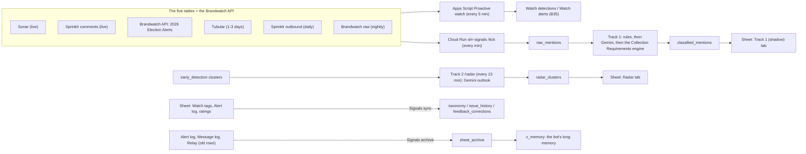

# Two-track SLRR signals: README

This explains everything built for the two-track system, how to turn each part on, and how to run it. It covers:
- the Cloud Run service `slrr-signals`;
- the BigQuery dataset `slrr_signals`;
- the bot's new **Signals** tab, and the archive, long memory and stuck-loop watchdog it controls;
- the reworked Proactive watch (the five tables, the Watch tags tab, Brandwatch held under 1,000 a day).

**Google Chat doesn't change.** Nothing in this system posts, reacts or emails. Classification happens before anything reaches a space. Track 1 runs in shadow mode, and its results go only to BigQuery and the sheet.

---

## 1. Read this first

| What | State now | Why |
|---|---|---|
| The bot (Control `B2`) | **OFF** (you paused it) | The new Apps Script code is deployed and waiting. On its first run back ON it converts the Watches tab, makes the Watch tags tab and cleans Watch detections (section 7). |
| Proactive watch (Control row 34) | ON, but **every watch is OFF** | Nothing is asked of Gemini until you set a watch's On to ON. |
| Signals tab (all 4 switches) | **OFF** | It's already on the sheet, after *Watch sources*. Nothing is sent, shown, archived or paused until you turn a row ON. |
| Cloud Run `slrr-signals` | Deployed; both schedules **PAUSED** | Its account can't read four of the five source tables yet (403). The dataset owners must grant read access (section 10). |

> [!IMPORTANT]
> **"Last modified" isn't the same as fresh posts.** Measured Nov 10:
> - **Fast (minutes to an hour):** Sonar, Sprinklr comments and the Brandwatch API.
> - **Late:** Brandwatch raw is a nightly batch (1–5 AM ET) that reaches back 1–6 days. New Tubular videos show up 1–3 days after posting (median ~43 h). Sprinklr outbound loads around 10 AM ET.
>
> The late sources can catch what others missed, but they can't beat Burson.

> [!WARNING]
> In the team's taxonomy, the descriptions of **"Employees - Other employee issues"** and **"Employees - Workforce reductions"** look swapped. They're kept word for word. Fix them on the *Watch tags* tab (column C) if they are.

---

## 2. How it fits together



| Piece | Runs where | How often | Default |
|---|---|---|---|
| Proactive watch (shadow test + Watch alerts) | Apps Script (the bot) | every 5 min | Row 34 ON, every watch OFF |
| Ingest + Track 1 (`/tick`) | Cloud Run `slrr-signals` | every minute | Paused |
| Track 2 radar (`/radar`) | Cloud Run `slrr-signals` | every 15 min | Paused |
| Sync, Show, Archive, Watchdog | Apps Script, Signals tab | sync/show every 10 min, archive once a day | OFF |

---

## 3. The sources

The only networks read, from every source: **X/Twitter, Reddit, Bluesky, Facebook, Instagram, YouTube, TikTok**. Every source reads English only, never Grok's posts, never shares or reposts, and nothing posted more than 72 h ago.

| Source | Table | Location | What's read |
|---|---|---|---|
| Sonar | `bsip-s-bsip-gg-26-2cf3.google_bg.sonar_raw` | us-central1 | New posts; posts that grew past the reach floor; posts that broke out (10× engagements, 1,000+) |
| Tubular | `brand-social-central-data.google_tubular_mentions.tubular_videos` | **us-central1** | New videos (YouTube and TikTok first), 10K+ views or a reach floor |
| Brandwatch mentions | `brand-social-central-data.raw_data.brandwatch_raw_mentions_base` | US | Tight filters, **≤ 1,000 a day** (below) |
| Sprinklr owned posts | `brand-social-central-data.reporting_data.sprinklr_outbound_reporting` | US | Google's own posts whose comments turned negative (other brands left out) |
| Sprinklr comments | `brand-social-central-data.reporting_data.sprinklr_inbound_comments` | US | Fans' comments on Google's posts in the last hour: a pile-on (5+ negative) or a 100K+ account |
| Brandwatch API | query "2026 Election Alerts" | n/a | Unchanged (the Apps Script watch only) |

### Brandwatch held under 1,000 a day
Brandwatch already tags its mentions with the SLRR taxonomy, in the category group **"V2 [MAIN] EN BSafety Landscape: Exposure & Risk Tags"**. That group is the bucket filter. Measured on the Nov 10 load:

| Filter (7 Google configs, English) | Mentions |
|---|---|
| Negative, all networks | 156,468 |
| Reddit / Bluesky / Facebook / Instagram, no shares | 35,052 |
| …with a Brandwatch exposure tag | 7,079 |
| …posted within 72 h | 2,217 |
| …reach ≥ 1,000 or 100+ engagements | **275** |

Other days come out near 0, because the table runs 1–6 days behind. A hard cap of 1,000 a day (counted per ET day) stays as a safety net. Three networks come from elsewhere:
- **X:** its mentions have no text in this table, and Sonar covers X live.
- **YouTube and TikTok:** from Tubular and Sonar.

The Brandwatch exposure tags travel with each mention. Gemini sees them, and they're stored as the source's own tags.

---

## 4. Track 1: official classification (strict)

Code: [`slrr_signals/rules.py`](../slrr_signals/rules.py), [`track1.py`](../slrr_signals/track1.py), [`classify.py`](../slrr_signals/classify.py). Settings: [`config/signals.yaml`](../config/signals.yaml) (`track1:`).

1. **Rules, no LLM**, in order:
   - Exclusions: "Google" used as a verb, Drive links, spam.
   - Previously reported: the same post in `issue_history` within 14 days.
   - The **urgent track**, where 0 engagements is enough: Sensitive Topic language, a source's Sensitive Topic tag, a KOF author, or a P0 hint.
   - Otherwise the **2K+ track**.
   - Everything else stops here. It's logged with `passed_rules = false` and never reaches Gemini.
2. **Gemini** classifies only the survivors (structured output, schema-checked): exposure tag, priority, Sensitive Topic, products, urgency, confidence, issue name, summary, rationale.
3. **The Collection Requirements engine**, the same one that QAs Burson's alerts (`triage_agent.qa.requirements`), decides whether the post is alertable (track, NEW/ONGOING).
4. **It qualifies** only when all of these hold:
   - it meets the requirements;
   - Gemini's confidence is ≥ 0.8;
   - it is relevant;
   - it wasn't reported in the last 14 days.
5. A qualifying row gets a **Google Search check of public coverage**, up to 150 a day.

Results go to `classified_mentions`. The rows that qualify wait in `v_track1_ready`. **Shadow mode:** nothing takes them yet (section 11). To see them, set the Signals tab's *Show* row to ON: they appear on the **Track 1 (shadow)** tab.

Caps: 40 Gemini classifications a tick, 1,500 a day.

## 5. Track 2: the radar (early signals)

Code: [`slrr_signals/track2.py`](../slrr_signals/track2.py).

1. **Candidates:**
   - The `early_detection` dataset's embedding clusters and velocity, read-only. Nothing is ever written there, and its alert queue is untouched.
   - The sources' own issue groupings in `raw_mentions` that Track 1 didn't qualify.
2. **Gemini assesses each cluster** (with a public-coverage check):
   - the **likelihood** it becomes an official alert if left alone (high, medium or low);
   - the closest exposure tag;
   - an **action** (promote, watch or discard);
   - why.
3. Results go to `radar_clusters`. With *Show* ON they appear on the **Radar** tab, high likelihood first.

Each cluster is re-assessed every 6 h, or sooner once its authors double. The radar assesses at most 12 clusters a run and 250 a day.

**First live run (Nov 11, 01:07 UTC):** 36 candidates, 12 assessed, 0 errors. All 12 came out low/discard, all routine chatter (Gemini model comparisons, Antigravity updates, a patched Chrome zero-day).

---

## 6. The BigQuery dataset `brand-social-central-data.slrr_signals` (US)

The DDL is versioned in [`analytics/slrr_signals/01_dataset_and_tables.sql`](../analytics/slrr_signals/01_dataset_and_tables.sql) (tables) and [`02_views.sql`](../analytics/slrr_signals/02_views.sql) (views). Both are safe to re-run.

| Table | Holds | Written by |
|---|---|---|
| `raw_mentions` | Every source's posts, one row per post and source (day-partitioned) | Cloud Run |
| `classified_mentions` | Track 1 results, with rules, model and prompt versions | Cloud Run |
| `radar_clusters` | Track 2 assessments | Cloud Run |
| `taxonomy` | The Watch tags tab, versioned (plus keywords and thresholds) | Bot (Signals sync) |
| `issue_history` | Alerts the bot forwarded (the previously-reported check) | Bot (Signals sync) |
| `feedback_corrections` | People's ratings: Watch detections, Track 1 and Radar reviews | Bot (Signals sync) |
| `sheet_archive` | Rows trimmed from the sheet, whole (JSON) | Bot (Signals archive) |
| `kof_list` | KOF accounts (empty for now: section 11) | n/a |
| `source_state`, `run_log`, `dead_letter`, `handoffs` | Watermarks and breakers, every run, items set aside, future hand-offs | Cloud Run |

| View | Use |
|---|---|
| `v_taxonomy_current` | The latest taxonomy version |
| `v_track1_latest` / `v_track1_ready` | Latest classification per post / the ones that qualify |
| `v_radar_latest` / `v_radar_review` | Latest assessment per cluster / high-likelihood ones for people |
| `v_issue_history_14d` | The 14-day previously-reported window |
| `v_memory` | **The bot's long memory**: issue history plus the archive, one row per alert |
| `v_source_health` / `v_metrics_daily` | Each source's health / each day's numbers |

---

## 7. The sheet

### The Signals tab
It's after *Watch sources* and made by the bot. Only the Value column (B) is yours.

| Row | Setting | Default | What ON does |
|---|---|---|---|
| B3 | Sync taxonomy, alert history and ratings to BigQuery | OFF | Every 10 min, the Watch tags tab goes to `taxonomy` (when it changed, else once a day). The Alert log's forwarded alerts go to `issue_history`, and new ratings go to `feedback_corrections`. |
| B4 | Show Track 1 and the radar on this sheet | OFF | Every 10 min, it refreshes the **Track 1 (shadow)** and **Radar** tabs from BigQuery. |
| B5 | Archive old rows to BigQuery, then trim them here | OFF | Once a day, after 3 AM ET (section 8). |
| B6 | Archive: days of the Alert log kept on the sheet | 21 | Never below 15 (the 14-day already-reported check reads it on the sheet) |
| B7 | Archive: days of the Message log kept on the sheet | 14 | Never below 7 |
| B8 | Archive: days of the Relay tab kept on the sheet | 30 | Never below 7 (protects old thread pairs) |
| B9 | Pause a background step that keeps getting stuck (30 min) | OFF | The watchdog pauses steps instead of only reporting them (section 9). |

Column C shows what each part is doing and is written by the bot, only when it changes.

### Track 1 (shadow) and Radar tabs
The bot makes these when *Show* is ON, after the Signals tab, protected with a warning. The **Review** column is yours, and your choice is kept across refreshes and synced once as feedback:
- **Track 1:** Correct · Wrong tag · Not an issue · Should be urgent
- **Radar:** Promote · Watch · Discard

### Proactive watch tabs (reworked)
- **Watches:** each watch picks exposure tags by priority, in columns: P0 exposure tags · P1 · P2 · Sensitive topics (`All`, blank, or tag names). Then come extra instructions, the impact rubric, *Flag at score*, Networks and Status. The bot converts the old tab in place on its first run and keeps each watch's On as it was. *Google brand safety (all)* picks All tags at a bar of 10. Both watches start OFF.
- **Watch tags (new):** the team's 58 exposure tags and Sensitive Topics, every one ON. The columns are Priority, Tag, Description, Short version, Also known as, On.
  - Gemini's yes/no question (AI.IF) uses the **short version**.
  - Its labeling (AI.CLASSIFY) uses the **full description**.
  - Edit it freely: the bot never rewrites it. With Sync ON, your edits become a new `taxonomy` version.
- **Watch sources:** the sources in section 3, each with its health.
- **Watch detections:** rows from the dropped sources are removed once: Brandwatch (BMIE), DSD story selection, Other alerts space, and the old Sprinklr outbound export. Rows from Sprinklr comments are kept. On Nov 11 that's 1,043 of 5,115 rows; a full copy of the tab from before the clean-up is saved locally at `data/watch_detections_backup_2026-11-11.csv` (git-ignored).

---

## 8. The archive and the bot's long memory

**What it does** (Signals B5 ON), once a day on the first quiet run after 3 AM ET, for each of the Alert log, Message log and Relay:
1. It takes the rows from the top that are older than the days set (B6–B8), up to 3,000 a tab a day. It never takes a row younger than 7 days (15 for the Alert log), and stops at the first row that's newer or has no date.
2. It **copies** them whole to `sheet_archive`, each with an insert id so a retry never doubles a row.
3. It **counts** them in BigQuery. If BigQuery doesn't have every row, nothing is trimmed and the status says so.
4. It checks the same rows are still at the top. Only then does it **delete** them from the sheet.

It only touches these three bot-made tabs, and never *Brand safety groups* or any tab people made. Row updates elsewhere in the bot check each row's key before writing, so trimming never misdirects an update.

**Long memory:** while the archive is ON, an analyst answer also gets the earlier alerts on the same post from `v_memory`. That's the archive plus the issue history, beyond what's still on the sheet. It's one query per post per hour (cached), and nothing on an error.

**Sizing:** today the Alert log has about 5,300 rows, the Message log about 10,000 and the Relay about 5,600. The sheet is at about 15% of its 10M-cell limit and was on course to fill around mid-2027. With the archive ON, it stays roughly flat.

> [!NOTE]
> The Results tab looks back `speed_days` + 2 days (9 by default), and the 14-day previously-reported check reads the Alert log on the sheet. So the bot never keeps fewer than 15 days of the Alert log, whatever B6 says. The default of 21 covers both.

---

## 9. Stuck loops and runaway calls

**In the bot (Apps Script):**
- **Watchdog** ([`Watchdog.gs`](../apps-script-chat-bot/Watchdog.gs)). Each background step marks itself as running and clears the mark when it ends. The steps are: Early detection check and review, Temp checks, Proactive watch, the Results, Follow-up and Analysis tabs, and Signals.
  - If Apps Script stops a run partway (a hang, or a loop hitting the 6-minute limit), the mark stays. The next run counts it against that step.
  - After **3 stops within an hour**, the step is paused for 30 minutes, if B9 is ON. If B9 is OFF, it's only reported.
  - **The alerts themselves are never wrapped, so they are never paused.**
- These existing limits stay in place:
  - `ApiGuard` (background work defers while Gemini or BigQuery calls run high);
  - 3-try limits on messages, write-backs, relays and drafts;
  - the watch cancels any BigQuery job still running after 4 minutes.

**In Cloud Run (`slrr-signals`):**
- One request at a time (concurrency 1, max 1 instance, plus a lock): runs never overlap.
- Every run has a time budget (50 s per tick, 240 s per radar run).
- Scheduler retries are 0: a missed tick is simply the next minute's.
- **Circuit breaker per source:** 3 failures in a row pause the source for 15 min, doubling up to 6 h, then one probe at a time.
- A source's place (watermark) moves only after its rows are written, so nothing is skipped or read twice.
- Rows already landed in the last 7 days are skipped.
- Items that fail 3 times go to `dead_letter` and are never retried.
- BigQuery refuses any read over ~6 GB.
- Gemini caps: 40 per tick and 1,500 per day (Track 1); 12 per run and 250 per day (Track 2); 210 web checks per day.
- **Seen live:** the first production tick hit 403 on all five sources. Each failure was isolated and counted, and the run ended normally as `partial`.

---

## 10. Operating it

**Access the service account needs.** The service runs as the `slrr-signals` service account of `brand-social-central-data`, the name `infra/09_slrr_signals.sh` builds; this repo never spells out an address. A dataset owner runs the lines below in a terminal signed in to their own account, and the last line needs Burson's owner of `bsip-s-bsip-gg-26-2cf3.google_bg`. Each grant is read-only, covers one table, and runs in that table's location (Tubular and Sonar are in us-central1).
```bash
P=brand-social-central-data
SA="serviceAccount:slrr-signals@${P}.iam.gserviceaccount.com"
grant() { bq query --project_id="$1" --location="$2" --use_legacy_sql=false "GRANT \`roles/bigquery.dataViewer\` ON TABLE \`$3\` TO \"${SA}\""; }
grant "$P" US "$P.raw_data.brandwatch_raw_mentions_base"
grant "$P" US "$P.reporting_data.sprinklr_outbound_reporting"
grant "$P" US "$P.reporting_data.sprinklr_inbound_comments"
grant "$P" us-central1 "$P.google_tubular_mentions.tubular_videos"
grant bsip-s-bsip-gg-26-2cf3 us-central1 "bsip-s-bsip-gg-26-2cf3.google_bg.sonar_raw"   # Burson's dataset owner runs this one
```
Already granted: WRITER on `slrr_signals` and READER on `early_detection`, plus the project roles BigQuery Job User, Vertex AI User and Logs Writer.

**Commands.** Run these from the repo root; `gcloud` must be signed in to `brand-social-central-data`.

| Task | Command |
|---|---|
| Start the ingest + Track 1 | `gcloud scheduler jobs resume slrr-signals-tick --location=us-central1 --project=brand-social-central-data` |
| Start the radar | `gcloud scheduler jobs resume slrr-signals-radar --location=us-central1 --project=brand-social-central-data` |
| Stop either | `gcloud scheduler jobs pause slrr-signals-tick --location=us-central1 --project=brand-social-central-data` (same with `slrr-signals-radar`) |
| Run one now (once resumed) | `gcloud scheduler jobs run slrr-signals-tick --location=us-central1 --project=brand-social-central-data` |
| Recent runs | `bq query --use_legacy_sql=false 'SELECT endpoint, status, started_at, TO_JSON_STRING(stats) AS stats, error FROM \`brand-social-central-data.slrr_signals.run_log\` ORDER BY started_at DESC LIMIT 10'` |
| Source health | `bq query --use_legacy_sql=false 'SELECT * FROM \`brand-social-central-data.slrr_signals.v_source_health\`'` |
| Service logs | `gcloud logging read 'resource.type="cloud_run_revision" AND resource.labels.service_name="slrr-signals"' --limit=30 --project=brand-social-central-data` |
| Redeploy after a code change | `./infra/09_slrr_signals.sh` (keeps the schedules paused; `START=1 ./infra/09_slrr_signals.sh` resumes them) |
| Re-classify the last N hours | `POST /reprocess?hours=N` (an OIDC call as the scheduler account) |
| Tests | `TRIAGE_LLM=fake .venv/bin/python -m pytest -q tests/test_slrr_signals.py` and `node apps-script-chat-bot/test/run_tests.js "signals"` |

**What it costs to run (estimates):**
- **BigQuery** scans about **100 GB a day**:
  - Sonar: ~270 MB a read, every 5 min.
  - Sprinklr comments: ~55 MB every 5 min.
  - Brandwatch raw: ~475 MB, only when the table changed.
  - Tubular and Sprinklr outbound: under 10 MB each.
- **Gemini** is held to the caps in section 9.

---

## 11. Not built yet (next steps)

| Item | Why it waits |
|---|---|
| Track 1 → chatbot hand-off (qualifying rows posted through the bot's existing cards) | Shadow first. Score Track 1 against Burson on the Track 1 tab before it goes live behind a new Control switch (default OFF). |
| Promote on the Radar tab feeding Track 1 | Today a Promote is recorded as feedback only. |
| Sonar fallback (the bot copies Sonar rows into `raw_mentions` if Burson won't grant access) | Waiting on Burson's answer. |
| Filling `kof_list` from the team's KOF lists | Track 1 uses Sonar's own KOF lists until then. |
| A date-based Alert log read (in place of the fixed last 4,000 rows) | The archive keeps the tab small, so it's lower priority now. |
| A Cloud Monitoring alert on repeated `slrr-signals` errors or growing lag | `run_log` and `v_source_health` show both today. |
| The Watch sources tab reading Cloud Run's `source_state` | The tab shows the Apps Script watch's own source health. |
| The web "discovery sweep" (search the web for Google + the ON tags) | Experimental: social coverage is thin. Web search is used for enrichment only. |
| An evaluation set built from `feedback_corrections` (Phase 5) | Needs a few weeks of reviews first. |

## 12. Files

| Path | What |
|---|---|
| [`apps-script-chat-bot/Signals.gs`](../apps-script-chat-bot/Signals.gs) | The Signals tab: sync, show, archive, memory |
| [`apps-script-chat-bot/Watchdog.gs`](../apps-script-chat-bot/Watchdog.gs) | The stuck-step watchdog |
| [`apps-script-chat-bot/ProactiveWatch.gs`](../apps-script-chat-bot/ProactiveWatch.gs) | The reworked watch (sources, tags, migration) |
| `apps-script-chat-bot/Main.gs`, `Bot.gs`, `Voice.gs` | Hooks: the watchdog around background steps, Signals at the end of the run, memory in analyst answers |
| [`slrr_signals/`](../slrr_signals/) | The Cloud Run service (ingest, rules, Track 1, Track 2, guards) |
| [`config/signals.yaml`](../config/signals.yaml) | Every service setting |
| [`analytics/slrr_signals/`](../analytics/slrr_signals/) | The dataset's DDL |
| [`infra/09_slrr_signals.sh`](../infra/09_slrr_signals.sh), [`infra/grant_dataset_access.py`](../infra/grant_dataset_access.py), `Dockerfile.signals`, `requirements-signals.txt` | Deploy |
| [`tests/test_slrr_signals.py`](../tests/test_slrr_signals.py), [`apps-script-chat-bot/test/switch_signals.test.js`](../apps-script-chat-bot/test/switch_signals.test.js) | Tests |
