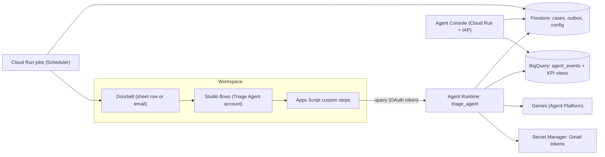

# Deploying the SLRR Triage Agent

Everything runs in one Google Cloud project. Chat I/O goes through Workspace Studio flows owned by the dedicated
Triage Agent Workspace account (**no Chat API configuration and no webhooks**).



| Component | Where | Deployed by |
|---|---|---|
| Agent (all operations) | Agent Runtime (Gemini Enterprise Agent Platform, formerly Vertex AI Agent Engine) | `05_deploy_agent_engine.py` |
| Minute-level work (SLA nudges, reminders, sent detection, digest, handover, Path B) | Cloud Run jobs + Cloud Scheduler | `06_jobs.sh` |
| Agent Console (metrics, review queue, escalations, rosters, settings, learning) | Cloud Run behind IAP | `07_console.sh` |
| State / analytics | Firestore / BigQuery | `03_firestore.sh` / `04_bigquery.sh` |
| Studio custom steps | Apps Script add-on (Triage Agent account) | [`../studio-addon/README.md`](../studio-addon/README.md) |
| Studio flows | Workspace Studio (Triage Agent account) | [`../flows/FLOW_SETUP.md`](../flows/FLOW_SETUP.md) |

## Before you start

- **Phase 0 spike first** ([`../flows/PHASE0_SPIKE.md`](../flows/PHASE0_SPIKE.md)): 1–2 days to confirm what Studio can trigger on
  (reactions, sheet changes) and the real Burson message format. Several config values depend on it.
- **Accounts and access:**
  - A GCP project for the agent (the gcloud default `brand-social-central-data` is **not** assumed). You need Owner, or
    the equivalent admin roles plus `roles/iam.serviceAccountUser` on the runtime service account.
  - The dedicated Triage Agent Workspace account, allowed to use Workspace Studio and Apps Script add-ons.
  - Read access to `bsip-s-bsip-gg-26-2cf3.google_bg` (Path B and Sonar lookups), requested from its owners.
- **Tools:**
  - `gcloud` and `bq`, authenticated as you: `gcloud auth login` + `gcloud auth application-default login`.
  - The project venv (`.venv/bin/pip install -r requirements.txt`, Python 3.12+).
  - `clasp` for the add-on.
  - Node 22 only for local Console builds; Cloud Build builds the images.

## Steps

```bash
cp infra/00_env.example infra/.env     # edit every PLACEHOLDER (git-ignored)
source infra/.env

infra/01_enable_apis.sh                # APIs
infra/02_service_accounts.sh           # runtime + scheduler SAs, IAM; Triage Agent account -> roles/aiplatform.user
infra/03_firestore.sh                  # Firestore (native) + composite indexes
infra/04_bigquery.sh                   # dataset, agent_events, KPI views

.venv/bin/python infra/05_deploy_agent_engine.py --dry-run   # validate the source package
.venv/bin/python infra/05_deploy_agent_engine.py             # create; prints the resource name
#   -> add AGENT_RESOURCE=projects/…/reasoningEngines/… to infra/.env, `source infra/.env`
.venv/bin/python infra/05_deploy_agent_engine.py --smoke     # op=health through :query, like the add-on

infra/06_jobs.sh                       # Cloud Run jobs + schedules
infra/07_console.sh                    # Console on Cloud Run + IAP; prints the URL + OAuth redirect URI
infra/08_gmail_oauth.sh client.json    # Gmail OAuth client -> Secret Manager (manual console steps in the script header)
```

Then:

1. **Studio add-on** ([`../studio-addon/README.md`](../studio-addon/README.md)): push with clasp as the Triage Agent account, link the
   project, and set the Script Properties: `AGENT_ENGINE_RESOURCE` = `AGENT_RESOURCE`, `TRIAGE_ENV`.
2. **Doorbell:** create the "Agent Outbox" sheet (owned by the Triage Agent account), share it with the runtime service
   account as Editor, and set `outbox.doorbell: sheet` + `outbox.sheet_id` in the Console's **Settings**. If the spike
   picks the email doorbell instead, set `outbox.doorbell: email` and connect the agent mailbox (see `08_gmail_oauth.sh`).
3. **Flows** ([`../flows/FLOW_SETUP.md`](../flows/FLOW_SETUP.md)): build flows 1–5 as the Triage Agent account. In **shadow**,
   every post step points at the private shadow space.
4. **Config:** in the Console's **Settings**, replace the remaining PLACEHOLDERs:
   - space ids;
   - IM shift roster and Burson roster (**Rosters**);
   - missing distros (GCPA, crisis chat, Regional Leads, Channel Owner, Brand);
   - Angie's email for the leadership protocol;
   - go/WD-Triage entry ids;
   - the Burson alert template labels.
5. **IMs connect Gmail** once from the Console (drafts are created in their own mailbox, From: the Brand Social alias).

## Shadow → production

| Gate | How to check |
|---|---|
| Decisions match IMs | Console **Overview**: first-pass yield, auto-fix rate, review queue size; `evals` golden set rerun with `--live` |
| Corrections are right | Console **Activity**: `correction.applied` reverts stay near zero for a week |
| No missed alerts | Console **Parity** (Burson vs in-house), and the Burson space vs the shadow space for a full rotation |
| Drafts are usable | IMs send drafts with ≤ 1 revision on average (`revisions_per_email`) |

To cut over:

1. Set `TRIAGE_ENV=prod` in `infra/.env`.
2. Re-run `05` (with `AGENT_RESOURCE` set), `06` and `07`.
3. Set the add-on's `TRIAGE_ENV` Script Property to `prod`.
4. Repoint the flows' post steps from the shadow space to the real spaces.
5. Path B: set `inhouse.parity_mode: false` in Settings once parity holds.

## Operations

- **Health:** run `.venv/bin/python infra/05_deploy_agent_engine.py --smoke`, or the Console header (agent + config version).
- **Logs:** use Cloud Logging.
  - Agent Runtime: `resource.type="aiplatform.googleapis.com/ReasoningEngine"`.
  - Jobs: `resource.type="cloud_run_job"`.
  - Console: `resource.type="cloud_run_revision"`.
- **Errors:** every failed operation emits an `error` event, on the Console's **Activity** page and in BigQuery `agent_events`.
- **Pause:**
  - Path B: `gcloud scheduler jobs pause slrr-inhouse-every-2-min --location=$REGION`.
  - Everything: turn the Studio flows off. Burson keeps posting as today, so nothing is lost.
- **Roll back the agent:** `git checkout <good-sha>`, then re-run `05` with `AGENT_RESOURCE` set.
- **Roll back the jobs or Console:** re-run `06`/`07` from the good sha. Images are tagged by git sha.
- **Secrets:**
  - The OAuth client lives in `OAUTH_CLIENT_SECRET`.
  - Gmail refresh tokens are `gmail-token-<sha256(email)[:40]>`.
  - Deleting an IM's token secret (or "Disconnect Gmail" in the Console) revokes the agent's access to that mailbox.

> [!NOTE]
> Attribution: the scripts export `CLOUDSDK_METRICS_ENVIRONMENT` with `datacloud.antigravity` and label BigQuery
> jobs/resources `datacloud:antigravity` (see `00_env.example`).
