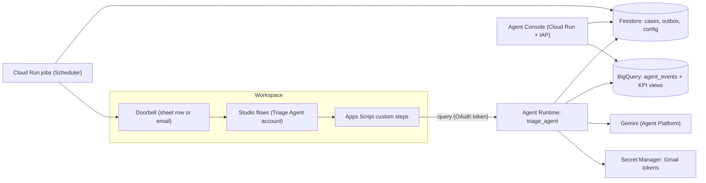

# Deploying the SLRR Triage Agent

Everything runs in one Google Cloud project. The QA chatbot reaches Chat as its own signed-in account through the
Chat API (**no Chat app, no Chat API configuration and no webhooks**), from the Cloud Run worker; Workspace Studio
flows are the older hand-over and are only needed for what has not moved to that sign-in yet.



| Component | Where | Deployed by |
|---|---|---|
| Agent (all operations) | Agent Runtime (Gemini Enterprise Agent Platform, formerly Vertex AI Agent Engine) | `05_deploy_agent_engine.py` |
| Minute-level work (SLA nudges, reminders, sent detection, digest, handover, Path B) | Cloud Run jobs + Cloud Scheduler | `06_jobs.sh` |
| Agent Console (metrics, review queue, escalations, rosters, settings, learning) | Cloud Run behind IAP | `07_console.sh` |
| Worker (Pub/Sub pushes for delivery and dead letters; the once-a-minute tick for knowledge, watches, temp checks, forecast, retention) | Cloud Run, private | `09_worker.sh` |
| Outbound delivery | Pub/Sub topics and push subscriptions | Console: Settings, Delivery, "Create what is missing" |
| State / analytics | Firestore / BigQuery | `03_firestore.sh` / `04_bigquery.sh` |
| Agent alerts (reads the sources, cleans and stages each post, BigQuery's triage; the review) | The `slrr-inhouse` job; the worker's tick and the Agent Runtime | `11_own_alerts.sh` for its BigQuery connection and salt; its tables are created from the Console |
| Studio custom steps | Apps Script add-on (Triage Agent account) | [`../studio-addon/README.md`](../studio-addon/README.md) |
| Studio flows | Workspace Studio (Triage Agent account) | [`../flows/FLOW_SETUP.md`](../flows/FLOW_SETUP.md) |

## Before you start

- **Phase 0 spike first** ([`../flows/PHASE0_SPIKE.md`](../flows/PHASE0_SPIKE.md)): 1–2 days to confirm what Studio can trigger on
  (reactions, sheet changes) and the real Burson message format. Several config values depend on it.
- **Accounts and access:**
  - A GCP project for the agent (the gcloud default `brand-social-central-data` is **not** assumed). You need Owner, or
    the equivalent admin roles plus `roles/iam.serviceAccountUser` on the runtime service account.
  - The dedicated Triage Agent Workspace account, allowed to use Workspace Studio and Apps Script add-ons.
  - Read access to `bsip-s-bsip-gg-26-2cf3.google_bg` (Path B and Sonar lookups), requested from its owners.
- **Tools:**
  - `gcloud` and `bq`, authenticated as you: `gcloud auth login` + `gcloud auth application-default login`.
  - The project venv (`.venv/bin/pip install -r requirements.txt`, Python 3.12+).
  - `clasp` for the add-on.
  - Node 22 only for local Console builds; Cloud Build builds the images.

## One command

```bash
gcloud auth login && gcloud auth application-default login
infra/deploy.sh --project PROJECT_ID --region REGION     # add --env prod, --agent-account ADDRESS when ready
```

It writes `infra/.env` if there is none, then runs every step below in order, deploys the worker (`09_worker.sh`) and
writes what it knows (project, region, addresses, Agent Runtime, dataset, agent alerts' connection and salt) into the Console's settings
(`10_seed_settings.py`, empty settings only). Safe to run again. You become the Console's first admin; its Dashboard
lists the setup steps left. Two steps stay manual: the Gmail OAuth client (`08_gmail_oauth.sh`) and the Studio flows.

## Steps

```bash
cp infra/00_env.example infra/.env     # edit every PLACEHOLDER (git-ignored)
source infra/.env

infra/01_enable_apis.sh                # APIs
infra/02_service_accounts.sh           # runtime + scheduler SAs, IAM; Triage Agent account -> roles/aiplatform.user
infra/03_firestore.sh                  # Firestore (native) + composite indexes
infra/04_bigquery.sh                   # dataset, agent_events, KPI views

.venv/bin/python infra/05_deploy_agent_engine.py --dry-run   # validate the source package
.venv/bin/python infra/05_deploy_agent_engine.py             # create; prints the resource name
#   -> add AGENT_RESOURCE=projects/…/reasoningEngines/… to infra/.env, `source infra/.env`
.venv/bin/python infra/05_deploy_agent_engine.py --smoke     # op=health through :query, like the add-on

infra/06_jobs.sh                       # Cloud Run jobs + schedules
infra/07_console.sh                    # Console on Cloud Run + IAP; prints the URL + OAuth redirect URI
infra/08_gmail_oauth.sh client.json    # Gmail OAuth client -> Secret Manager (manual console steps in the script header)
infra/11_own_alerts.sh                 # agent alerts: the BigQuery connection for Vertex AI, the salt's secret, Vertex AI's cache off
```

Then:

1. **Studio add-on** ([`../studio-addon/README.md`](../studio-addon/README.md)): push with clasp as the Triage Agent account, link the
   project, and set the Script Properties: `AGENT_ENGINE_RESOURCE` = `AGENT_RESOURCE`, `TRIAGE_ENV`.
2. **Doorbell:** create the "Agent Outbox" sheet (owned by the Triage Agent account), share it with the runtime service
   account as Editor, and set `outbox.doorbell: sheet` + `outbox.sheet_id` in the Console's **Settings**. If the spike
   picks the email doorbell instead, set `outbox.doorbell: email` and connect the agent mailbox (see `08_gmail_oauth.sh`).
3. **Flows** ([`../flows/FLOW_SETUP.md`](../flows/FLOW_SETUP.md)): build flows 1–5 as the Triage Agent account. Until the
   cutover, every post step points at a Google-only test space (never the Burson space).
4. **Config:** in the Console's **Settings**, replace the remaining PLACEHOLDERs:
   - space ids;
   - IM shift roster and Burson roster (**Rosters**);
   - missing distros (GCPA, crisis chat, Regional Leads, Channel Owner, Brand);
   - Angie's email for the leadership protocol;
   - go/WD-Triage entry ids;
   - the Burson alert template labels.
5. **IMs connect Gmail** once from the Console (drafts are created in their own mailbox, From: the Brand Social alias).

## Agent alerts

`infra/deploy.sh` does the Google Cloud side: it redeploys the Agent Runtime with the review, runs `11_own_alerts.sh` and fills the two
settings that name the connection and the salt. Then, in the Console:

1. **Integrations**, Find and fill: adds the two tables only agent alerts read and ticks the tables it reads.
2. Share the KOF sheet (Viewer) with the runtime service account. Enter the sheet's link under **Settings, Agent alerts**.
3. **Settings, Switches**: turn on Change BigQuery from here. On **Agent alerts**, press Create the tables.
4. **Agent alerts**, Rules: add the rules.
5. **Settings, Switches**: turn on Agent alerts.
6. **Agent alerts**, Run now: one run and one review at once. Sources shows what each source handed over; a source that could not be read
   says why, in BigQuery's own words.
7. To post in Chat, choose the space under Settings, Agent alerts, then turn on Post agent alerts in Chat.

Run on its own, `11_own_alerts.sh` leaves two things: redeploy the Agent Runtime (`05`; until then the worker reviews, and each alert's
record says so), and fill the connection and the salt's secret (`10_seed_settings.py`, or Settings, Agent alerts).

`11_own_alerts.sh` turns Vertex AI's in-memory cache off, for zero data retention. The setting is the project's: it covers every Gemini
call in the project, in every region. It takes `roles/aiplatform.admin`; `--keep-cache` skips it. Google keeps prompts for abuse
monitoring until it exempts the project, on request.

## Cutover to production

| Gate | How to check |
|---|---|
| Decisions match IMs | Console **Overview**: first-pass yield, auto-fix rate, review queue size; `evals` golden set rerun with `--live` |
| Corrections are right | Console **Activity**: `correction.applied` reverts stay near zero for a week |
| No missed alerts | Console **Parity** (Burson vs in-house) for a full rotation |
| Drafts are usable | IMs send drafts with ≤ 1 revision on average (`revisions_per_email`) |

To cut over:

1. Set `TRIAGE_ENV=prod` in `infra/.env`.
2. Re-run `05` (with `AGENT_RESOURCE` set), `06` and `07`.
3. Set the add-on's `TRIAGE_ENV` Script Property to `prod`.
4. Repoint the flows' post steps from the test space to the real spaces.
5. Path B: set `inhouse.parity_mode: false` in Settings once parity holds.

## Operations

- **Health:** run `.venv/bin/python infra/05_deploy_agent_engine.py --smoke`, or the Console header (agent + config version).
- **Logs:** use Cloud Logging.
  - Agent Runtime: `resource.type="aiplatform.googleapis.com/ReasoningEngine"`.
  - Jobs: `resource.type="cloud_run_job"`.
  - Console: `resource.type="cloud_run_revision"`.
- **Errors:** every failed operation emits an `error` event, on the Console's **Activity** page and in BigQuery `agent_events`.
- **Pause:**
  - Path B: `gcloud scheduler jobs pause slrr-inhouse-every-2-min --location=$REGION`.
  - Everything: turn the Studio flows off. Burson keeps posting as today, so nothing is lost.
- **Roll back the agent:** `git checkout <good-sha>`, then re-run `05` with `AGENT_RESOURCE` set.
- **Roll back the jobs or Console:** re-run `06`/`07` from the good sha. Images are tagged by git sha.
- **Secrets:**
  - The OAuth client lives in `OAUTH_CLIENT_SECRET`.
  - Gmail refresh tokens are `gmail-token-<sha256(email)[:40]>`.
  - Deleting an IM's token secret (or "Disconnect Gmail" in the Console) revokes the agent's access to that mailbox.

> [!NOTE]
> Attribution: the scripts export `CLOUDSDK_METRICS_ENVIRONMENT` with `datacloud.antigravity` and label BigQuery
> jobs/resources `datacloud:antigravity` (see `00_env.example`).
